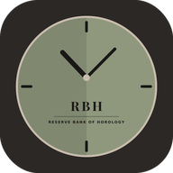
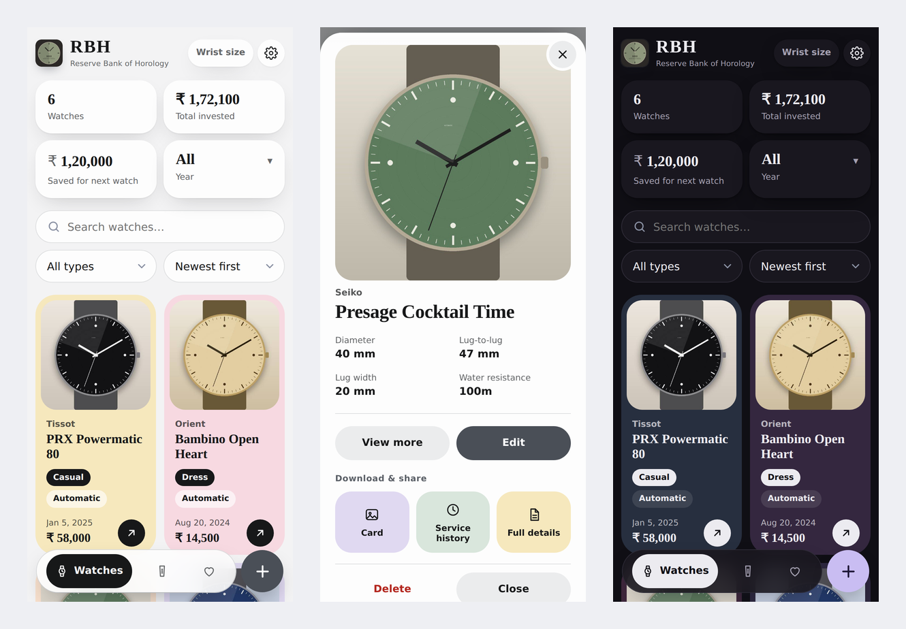

# RBH · Reserve Bank of Horology

**A private vault for your watch collection.**
Photos, specs, invoices, straps, service history and a wishlist, all kept on your own device.

*Made by SS, with love. Jai Hind. © 2026 SS*

---

## Contents

1. [What is RBH?](#what-is-rbh)
2. [Highlights](#highlights)
3. [Features in detail](#features-in-detail)
4. [Privacy](#privacy)
5. [Security](#security)
6. [Install it as an app](#install-it-as-an-app)
7. [Backups and moving your data](#backups-and-moving-your-data)
8. [Devices and browsers](#devices-and-browsers)
9. [Limits to know about](#limits-to-know-about)
10. [Publishing your own copy on Netlify via GitHub](#publishing-on-netlify-via-github)
11. [Project structure](#project-structure)
12. [Releasing an update](#releasing-an-update)
13. [Troubleshooting and FAQ](#troubleshooting-and-faq)
14. [More screenshots](#more-screenshots)
15. [Licence](#licence)
16. [Contact and credits](#contact-and-credits)

---

## What is RBH?

Like many collectors, I kept my watches in a physical box while their photos ended up scattered across my camera roll. I built RBH to be the single place that fixes this: photos, specs, purchase details, invoices, strap combinations, service history and a wishlist of future pieces.

The name is inspired by the Reserve Bank of India. Here, instead of managing monetary reserves, you vault and safeguard your watches.

RBH is **offline-first**. There is no account, no server and no cloud database. Everything you enter stays in your own browser, on your own device. The trade-off is that you manage your own backups, and the upside is that your photos, invoices and watch details never leave your device.

> RBH is an independent project. It is not affiliated with, or endorsed by, any bank, regulatory authority, watch brand or manufacturer.

## Highlights

- **Your whole collection in one place**: up to 5 photos per watch, 30+ detail fields, invoices, service records.
- **Wishlist and straps** with their own screens and totals.
- **Private by design**: no sign-up, no tracking, no analytics, nothing sent anywhere.
- **Works offline** and installs like a native app on Android, iPhone, iPad, Windows, macOS and Linux.
- **Encrypted backups** (AES-256) and an optional **PIN lock**.
- **Beautiful and fast**: pastel tiles, 12 whole-app colour themes, light and dark mode, smooth on phones, tablets and desktops.
- **Share-ready exports**: RBH-branded image cards, a bank-statement style PDF, service history and detail sheets.
- **Careful by default**: unsaved-change warnings, undo after delete, strict security rules, hostile-file protection.

---

## Features in detail

### Your collection (the *Watches* tab)

Each watch can hold the following details. Only brand and model are required.

| Group | Fields |
| --- | --- |
| **Basics** | Brand, model, reference / model number, serial number, type, condition |
| **Purchase** | Purchase date, price paid, bought from, warranty (in years) |
| **Movement** | Movement type, movement / caliber |
| **Case and dimensions** | Case diameter, lug-to-lug, lug width, thickness (all in mm), case back type, crown action, water resistance, crystal, AR coating, luminous material, strap / bracelet |
| **Features and notes** | Comma-separated features, free-text notes |
| **Service history** | Any number of dated records with type, cost, notes and attached files |
| **Documents** | Invoices and other papers attached to the watch |

**Pick-lists, with a custom option where it makes sense**

- **Type**: Dive, Field, Dress, Pilot, Chronograph, Digital, Smart, Dual-time / GMT, Sport, Casual, GADA, Other, or your own.
- **Condition**: New, Pre-owned, Vintage, Gift.
- **Movement type**: Automatic, Manual wind, Quartz, Solar, Digital, Spring Drive, Smart, Other, or your own.
- **Case back**: Screw Down, Snap On, Screwed In, Ring Locked, or your own.
- **Crown action**: Push-pull, Screw-down, Lever-locked, or your own.
- **Crystal**: Sapphire, Mineral Glass, Acrylic, Sapphire Coated Mineral, Hardlex, or your own.
- **AR coating**: Yes, No, or your own.
- **Luminous**: Super LumiNova, LumiNova, Chromalight, LumiBrite, Electroluminescent (EL) Backlight, LED Backlight, Gaseous Tritium Light Sources (GTLS), No Lume, or your own.
- **Strap / bracelet**: Leather, Metal, FKM, Rubber, Nylon, Sailcloth, Suede, Canvas, or your own.

**Photos**

- Up to **5 photos per watch**, chosen from your gallery (phones may also offer the camera).
- Photos are automatically resized and compressed on your device, so large camera photos do not fill your storage.
- In the add / edit form, tap a photo to make it the **cover**, and drag photos to **reorder** them.
- Photos open in a full detail view with a thumbnail strip.

**Invoices and documents**

- Attach up to **3 documents per watch**, as **PDF (up to 3 MB each)** or images.
- Open them again inside RBH whenever you need them.

**Service history**

- Add records such as **Movement service**, **Battery replacement**, **Repair**, **Water-resistance check** or **Other** (with a box to describe what was done).
- Each record carries a date, an optional cost, notes about where it was done, and up to **2 attached files** (for example the service receipt).
- Download your service history as an **image or PDF**.

**At a glance**

- Each watch shows how long you have owned it, for example "Owned 6 yrs 4 mo".
- Every card shows brand, model, key tags, purchase date and price, with a one-tap arrow into the full detail view.

### Dashboard

At the top of the Watches tab you see four tiles:

- **Watches**: how many you own.
- **Total invested**: the sum of what you paid.
- **Saved for next watch**: a figure you can type in yourself to track a savings goal. It is remembered between visits.
- **Year**: filter the whole collection (and the totals) by purchase year.

### Find things quickly

- **Search** across brand, model, reference, type, movement, caliber, strap, seller, notes, luminous, crystal, AR coating, case back, crown, priority, link and features.
- **Filter by type** (Dive, Dress, Pilot and so on).
- **Sort**: Newest first, Oldest first, Brand A–Z, Price high–low, Price low–high.
- Press **/** on a keyboard to jump straight to the search box.

### Wishlist

Keep the watches you hope to buy, separate from your collection.

- Brand, model, **priority** (High, Medium, Low), **target price** and a **link** to the shop or listing.
- Sort by Priority, Recently added, Brand A–Z, or price.
- When you buy one, **move it to your collection** in one tap and fill in the purchase details.
- Links are only ever opened if they are normal web addresses, and they open safely in a new tab.

### Straps

A small collection of its own.

- Name, material, lug width, purchase date and price.
- Up to **3 photos** per strap.
- Dashboard with the **number of straps** and **total invested** in straps.
- Sort by Newest first, Oldest first, Name A–Z or Lug width.
- Download a strap **image card**.

### Wrist size

Save your wrist size in **inches or centimetres**. It is shown on a button at the top of the home screen. Values outside a sensible range are politely rejected.

### Currency

Choose how prices are shown: **₹** (default), **$**, **€**, **£**, **AED**, **¥**, **CHF**, **A$** or **C$**. Indian digit grouping is used for amounts, for example ₹ 1,72,100.

### Sharing and exporting

| What | Format | Notes |
| --- | --- | --- |
| **Image card** | JPEG | A professional, RBH-branded card with the cover photo, brand and model. Made for social media. Available for every watch, wishlist item and strap. |
| **Full details sheet** | Image or PDF | Everything recorded about one watch. |
| **Service history** | Image or PDF | One watch's service record. |
| **Statement of holdings** | PDF | A bank-statement style document of your collection. You choose what to include (**Current collection**, **Wishlist**, **Straps**, any combination) and add your name as the collector. |
| **Discreet copy** | PDF | Same statement, but the totals, saved amount, counts, purchase dates and prices show a crossed-eye icon instead. Good for sharing without revealing the money side. |
| **Export JSON** | JSON | Your data in a readable, portable file. |
| **Export CSV** | CSV | Opens cleanly in Excel and Google Sheets. Cells that could be read as formulas are neutralised. |
| **Import JSON** | JSON | Brings an export back in. Every item is checked and cleaned on the way in. |

### App lock (PIN)

- Choose a **4 to 8 digit PIN**.
- Ask for it **every time the app is opened**, or **after being away** for 1, 2, 5, 10, 15, 30 or 60 minutes.
- A **Lock now** button appears in the header once a PIN is set.
- After 5 wrong attempts the app makes you wait, with the wait growing each time (30 seconds, 1 minute, 5 minutes, 15 minutes, 1 hour). The count survives a page reload, so it cannot be skipped by refreshing.
- Opening your photo or file picker does not lock you out by accident.
- There is **no PIN reset** (by design). Keep a recent backup in case you forget it. The PIN is stored only as a salted, slow hash. See [Security](#security) for what a PIN does and does not protect.

### Backups

- **Encrypted backup** of everything: watches, photos, straps, invoices and settings, locked with a password you choose (at least 8 characters).
- **Restore** on any device: open RBH there, choose Restore, pick the file and enter the password.
- A friendly reminder tells you when your last backup was made.

### Look and feel

- **12 colour themes** that colour the *whole app*, not just the buttons:
  - **Classic**: Sage green, Rolex green, Classic gold, Navy blue, Burgundy, Graphite (the default).
  - **Pastel**: Lavender, Blush pink, Peach, Butter yellow, Mint, Sky blue.
- **Light, Dark or Automatic** (follows your device).
- Rounded pastel tiles, a floating tab bar on phones, a top tab bar on larger screens.
- Rounded, theme-matching drop-down menus instead of plain system pop-ups.
- Every screen is designed for **phones, tablets, laptops and large monitors**, in portrait and landscape.
- Printing a page gives a clean list of your collection.

### Install and offline

- Install RBH as an app on any major platform and use it **fully offline**.
- Home-screen shortcuts for **Add a watch**, **Wishlist** and **Straps** (on platforms that support shortcuts).
- When a new version is published, the app tells you and offers a one-tap **Reload**.

### Built to be forgiving

- **Unsaved-change warnings** on every form and sheet. Settings changes can be previewed live, and you are asked before leaving them unsaved.
- **Undo** after deleting a watch or strap. Deleting asks you to confirm, and the confirmation relaxes after a few seconds.
- Forms point at the exact field that needs fixing.
- If your browser blocks storage (for example some private modes), RBH warns you clearly instead of failing silently.
- A friendly message appears if your browser does not support a feature, such as encryption.

### Accessible

- Works with a **keyboard** (Tab, Enter, Space, arrow keys, Escape, and `/` for search).
- Labels, tab states and pop-up messages are announced by **screen readers**.
- Large tap targets on touch devices, visible focus outlines, and text that meets contrast guidelines in all 12 themes, in light and dark.
- Honours **reduced-motion** settings and Windows **high-contrast** mode.

---

## Privacy

Your collection is personal. RBH is designed so that **nobody but you** can see it.

| Question | Answer |
| --- | --- |
| Do I need an account? | **No.** There is no sign-up, login or email. |
| Where is my data stored? | **Only in your own browser**, on your own device (IndexedDB and local storage). |
| Does RBH send my data anywhere? | **No.** The app makes no network requests for your data. A security rule built into the app and the hosting setup blocks it from talking to other servers. |
| Is there tracking or analytics? | **No.** No analytics, no cookies, no advertising, no fingerprinting, no third-party scripts, fonts or images. |
| Can I (SS) see your collection? | **No.** There is no server that receives it, so there is nothing for me to see. |
| What about my photos and invoices? | They stay on your device. They only leave it if *you* export, back up or share them. |
| Are my backups private? | Yes. They are encrypted with your password. Without the password they cannot be read, and the password cannot be recovered. Keep it safe. |
| Does the contact link track me? | The *Contact or Support RBH* link opens my Reddit profile only when you tap it. |
| What does the web host see? | Like any website, the host (Netlify) may keep standard server logs, such as your IP address and the pages requested, when you load the site. Your collection is never part of that, because it is never sent. |
| Is there a children's or age gate? | No personal data is collected, so none is needed. |

**Your responsibilities**

- Clearing a site's data in your browser, or uninstalling the browser, **deletes your RBH data**. Make backups.
- Anyone who can use your unlocked phone or computer can open the app. Use the PIN lock and your device's own lock screen.
- Do not use RBH in a shared-computer or private window if you want your data to stay.

---

## Security

RBH is built to keep your data safe even if something goes wrong.

- **Strict content security policy.** The app is allowed to load only its own files, so it cannot fetch or send data to anywhere else. The same policy is set in the page itself and in the hosting headers.
- **Hardened hosting headers** (`netlify.toml`): HTTPS only (HSTS), no framing (clickjacking protection), no MIME sniffing, no referrer sent, same-origin isolation, and unused device features (camera, microphone, location, USB and more) switched off.
- **Encrypted backups.** AES-256-GCM with a key derived from your password using PBKDF2-SHA-256 (600,000 rounds), a fresh random salt and IV every time, and an authenticated header, so a tampered or wrong-password file is rejected.
- **PIN protection.** The PIN is never stored. Only a salted PBKDF2-SHA-256 hash (150,000 rounds) is kept. Repeated wrong guesses trigger growing waits that survive reloads.
- **Hostile-file protection.** Everything imported from a file is validated and cleaned: wrong types, oversized values, scripts, odd links and fake image data are removed. All text is displayed as plain text, never as HTML.
- **Safe links.** Only `http(s)` links are made clickable, and they open with `noopener noreferrer`.
- **Excel-safe CSV.** Cells starting with `=`, `+`, `-` or `@` are neutralised so they cannot run as spreadsheet formulas.
- **Safe document viewing.** PDFs are opened as PDFs only, never as web pages.
- **No hidden code.** There is no build step and no third-party packages. What you see in this repository is exactly what runs.

> **About the PIN:** it is a *front door* for the app on your device. It keeps casual snoopers out, but it does not encrypt the data stored in your browser. For real protection of your data, keep your **encrypted backup** safe and use your device's own screen lock and disk encryption.

---

## Install it as an app

Open the hosted RBH address in your browser, then:

| Device and browser | How to install |
| --- | --- |
| **Android: Chrome, Edge, Brave, Samsung Internet** | Open **Settings** in RBH and tap **Install app**, or open the browser menu and choose **Install app** or **Add to Home screen**. |
| **Android: Firefox** | Open the Firefox menu and tap **Install**. |
| **iPhone and iPad: Safari** | Tap the **Share** button, then **Add to Home Screen**. |
| **iPhone and iPad: Chrome, Edge** | Tap the **Share** button, then **Add to Home Screen**. |
| **Windows and Linux: Chrome, Edge, Brave** | Click the **install icon** in the address bar, or open **Settings** in RBH and click **Install app**. |
| **macOS: Chrome, Edge, Brave** | Click the **install icon** in the address bar. |
| **macOS: Safari** | Choose **File, then Add to Dock**. |
| **Firefox on desktop** | Firefox desktop cannot install web apps. RBH works perfectly in a normal tab. |

Once installed, RBH opens in its own window with its own icon and works without internet.

> **iPhone and iPad:** an app added to the Home Screen has its **own separate storage**, apart from Safari. Install first, then [restore your backup](#backups-and-moving-your-data) inside the installed app. Safari may also clear data for websites you have not opened in about a week, so the Home Screen app plus regular backups is the safest setup.

---

## Backups and moving your data

Data lives in the browser where you entered it, and each address (website) has its own storage. To move to a new device, a new browser or a new web address:

1. On the **old** place: open **Settings**, tap **Backup**, choose a strong password, and save the file (`rbh-backup-YYYY-MM-DD.json`).
2. Move the file to the **new** place (cloud drive, email to yourself, USB, etc.).
3. On the **new** place: open **Settings**, tap **Restore**, pick the file, and enter the same password.

Restoring *adds* to what is already there, so it is safe to try.

**Coming from the older single-file version of RBH?** That version stores its data under the file you opened. Make a backup there and restore it on the hosted site.

**Good habits:** back up after adding something important, keep two copies in different places, and never lose the password.

---

## Devices and browsers

RBH is built with web standards that every modern browser supports, so it works on:

- **Android**, **iPhone and iPad (iOS and iPadOS)**, **Windows**, **macOS**, **Linux** and Chromebooks.
- **Chrome, Edge, Brave, Opera, Samsung Internet, Safari and Firefox.**

| | Minimum |
| --- | --- |
| Chrome, Edge, Brave, Opera (desktop and Android) | Version 100 or newer recommended |
| Safari (macOS, iOS, iPadOS) | Version 15 or newer |
| Firefox (desktop and Android) | Version 100 or newer recommended |
| Samsung Internet | Version 17 or newer |

Encrypted backups and the PIN lock need a secure address (HTTPS), which the hosted site always has.

**How it has been tested:** all features were exercised on Chromium-based browsers across phone, tablet, laptop and large-monitor sizes (including simulated iPhone, iPad, Pixel, Galaxy and desktop profiles), in light and dark mode, offline, and with restricted storage. Safari and Firefox support is by design, using only standard features with fallbacks where needed. If you find anything odd in a particular browser, please [get in touch](#contact-and-credits).

---

## Limits to know about

| Item | Limit |
| --- | --- |
| Photos per watch | 5 |
| Photos per strap | 3 |
| Documents per watch | 3 (PDF up to 3 MB each, or images) |
| Files per service record | 2 |
| PIN length | 4 to 8 digits |
| Backup password | At least 8 characters |
| Storage | Set by your browser. If it fills up, RBH tells you to make a backup. |

